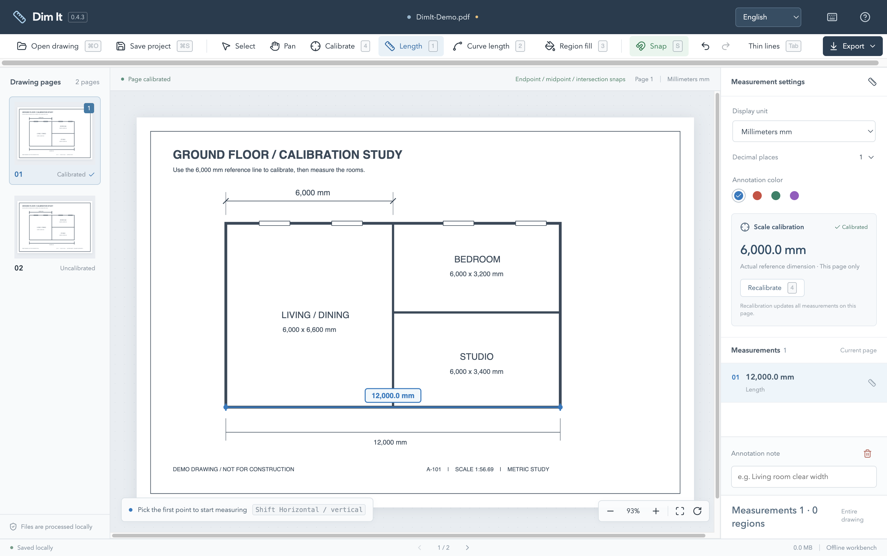
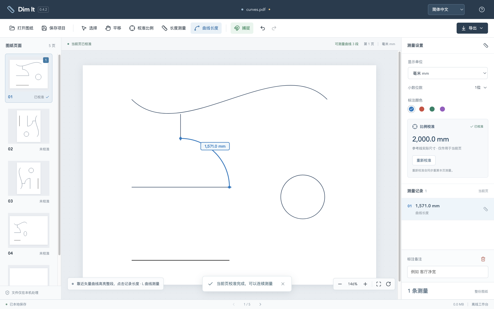
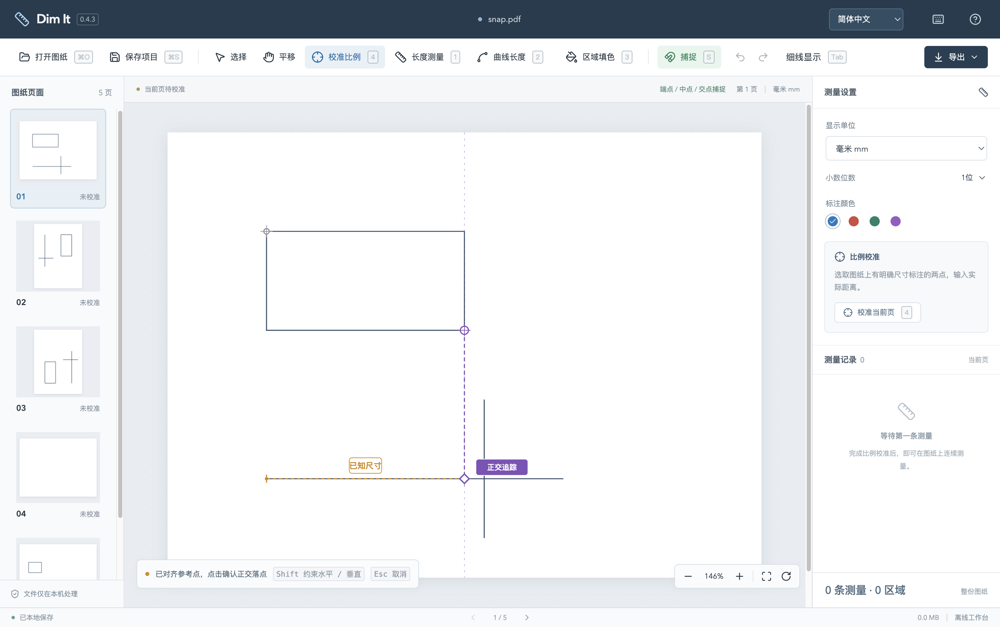
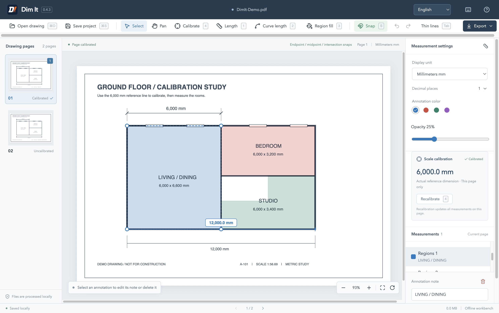
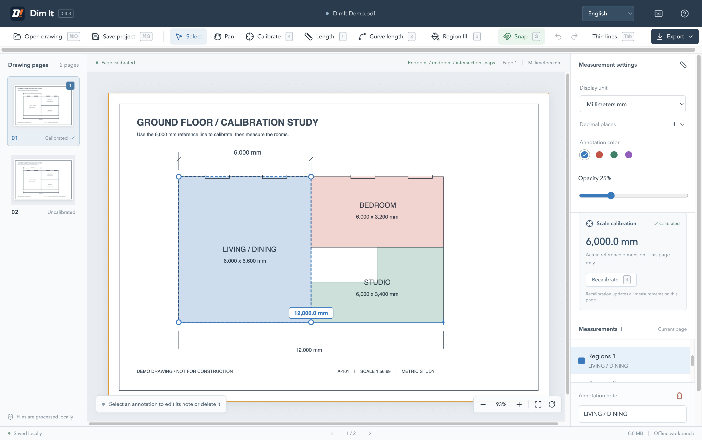

# Dim It — PDF Measurement and Annotation Tool

**Offline PDF measurement and annotation for Windows and macOS.** Open a drawing, calibrate it using a known dimension, then measure lines, curves and mark regions. Built for everyday architectural, interior and engineering drawing checks.

**Use cases.** Check dimensions on architectural floor plans, measure distances on interior construction PDFs, calibrate PDF scale, measure arc and curve lengths, and mark drawing regions with color.

*Damn it. Dim it.*

English · [简体中文](README.md) · [Download the latest release](https://github.com/bzbaizhen/dim-it/releases/latest) · [Detailed usage](docs/usage.en.md)

## Download and install

Choose the installer for your platform from Releases. The current version is **0.4.3**. [Download the latest release](https://github.com/bzbaizhen/dim-it/releases/latest)

| Platform | Installation | Signing status |
| --- | --- | --- |
| macOS Apple Silicon (ARM64) | Open the `.dmg` and drag Dim It into Applications | Developer ID signed and notarized by Apple |
| Windows 10 / 11 x64 | Run the `.exe` wizard and choose an installation location | Unsigned, so Windows may show a security warning |

The Mac app has been run on Apple Silicon hardware. The Windows installer is cross-built and awaits Windows hardware validation. Each Release includes `SHA256SUMS.txt` for checking downloaded files.

## How to calibrate PDF scale and measure drawings

1. **Open a drawing.** Click Open or drag a PDF into the window. You can also try the built-in demo.
2. **Calibrate.** Press **4**, pick both ends of a known dimension, and enter its actual length and unit, such as `6000` mm.
3. **Measure.** Press **1** for a straight length, or **2** to pick an existing vector curve and measure its full path. Results appear in the list on the right.
4. **Save and share.** Save a `.planmeasure` project for continued editing, or export an annotated PDF or dimension CSV.

Press **3** to start a region fill directly. Switch **简体中文 / English** at the top of the window. Your language preference is saved automatically. The illustrated startup guide can be skipped and reopened through Help in the top-right corner.

## Core features

| Feature | What you can do |
| --- | --- |
| Length measurement | Measure between two points, pick whole vector arcs and curves, or measure a closed curve's perimeter |
| Calibration and units | Calibrate each page independently and use mm, inches, feet or fractional feet/inches |
| Snapping and alignment | Highlight endpoints, midpoints and intersections, with Shift orthogonal constraints and SmartTrack guides |
| Region fills | Drag rectangles or click polygon vertices, then edit color, opacity, notes and vertices |
| Drawing navigation | Change pages, pan, zoom, rotate and toggle uniform thin lines with Tab |
| Annotation editing | Add notes, change colors, select, delete, undo and redo |
| Faster operation | Customize shortcuts and see current bindings in button tooltips and native menus |

### Measure PDF arc and curve lengths

After calibration, press **2**, hover to preview the highlighted curve, then click to record its full length.

### Snapping and SmartTrack

Snap points are highlighted in green. Hold **Shift** for horizontal or vertical constraints, then hover over nearby snap points to acquire SmartTrack references and align along purple guides.

### Rectangle and polygon fills

Press **3**, then drag a rectangle or click polygon vertices. Default opacity is 25%. Select a completed region to edit its style, note or vertices.

### Tab thin-line display

Press **Tab** on the canvas to reveal vector stroke centerlines and identify intersections. You can toggle it while calibrating, measuring or drawing.

See the guide for detailed picking, closing, vertex editing and shortcut settings. [Detailed usage](docs/usage.en.md)

## Shortcuts

`Mod` means Command on Mac and Ctrl on Windows. Press **Mod+, / F1** or click the keyboard icon to view and customize bindings.

| Action | Default |
| --- | --- |
| Line / Curve / Fill / Calibrate | 1 / 2 / 3 / 4 |
| Previous / Next page | A / D, or PageUp / PageDown |
| Fit page / 100% | F / G |
| Zoom out / In | Z / X, or − / + |
| Rotate clockwise / Counterclockwise | R / Shift+R |
| Thin lines | Tab |
| Snap / Edit note / Delete | S / E / Delete |
| Undo / Redo | Mod+Z / Mod+Shift+Z, plus Ctrl+Y on Windows |
| Open / Save project | Mod+O / Mod+S |
| Export PDF / CSV | Mod+E / Mod+Shift+E |
| Shortcut settings | Mod+, / F1 |

Use the middle mouse button or **Space + drag** to pan temporarily, **Shift** for orthogonal constraints and SmartTrack, and **Alt** for temporary free picking. Tab in fields and dialogs moves focus.

## Saving and privacy

Drawing processing and project recovery happen locally. Measurement and annotation work offline.

| Format | Purpose | Contents |
| --- | --- | --- |
| `.planmeasure` | Save work for continued editing | Original PDF, page scales, measurements, fills and notes |
| PDF | Share or print annotated results | Drawing with dimensions and fills drawn onto the pages |
| CSV | Organize a dimension list | Lengths, millimeter values and notes |

Local recovery retains the most recent work. Save your project before switching drawings. Documentation screenshots use generated geometry and the built-in demo.

## Limits and common questions

- **Can I measure a scanned drawing?** Yes, using manual calibration and picking. Automatic snapping and whole-curve detection depend on vector paths in the PDF.
- **What if a page has several scales?** Each page stores one scale. Save separate projects for details at different scales. Scan stretching or perspective distortion affects results. Check against another known dimension.
- **How do I keep editing an exported PDF?** Open the saved `.planmeasure` project in Dim It to adjust measurements and regions.
- **Why can't I select a curve?** It may have been converted to an image or straight polylines. Continuous vector curve selection follows PDF path boundaries.
- **Why does saving report an unfinished draft?** Close the region or press Esc to cancel its draft, then save.
- **How do I open an encrypted PDF?** Unlock and save it in a reader before importing it into Dim It.

## Feedback and development

When reporting an issue, include your OS, app version, reproduction steps and a sanitized example. [Report an issue](https://github.com/bzbaizhen/dim-it/issues)

- [Releases and change notes](https://github.com/bzbaizhen/dim-it/releases)
- [Detailed usage](docs/usage.en.md)
- [Local development, builds and signed releases](docs/development.en.md)

The project's current license marker is `UNLICENSED`, as recorded in its configuration. Contact the maintainer through Issues for licensing inquiries. [Project configuration](package.json)
