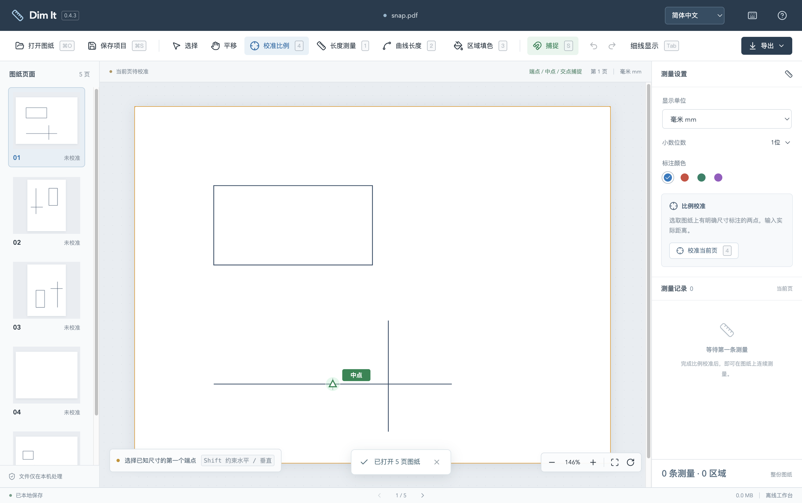
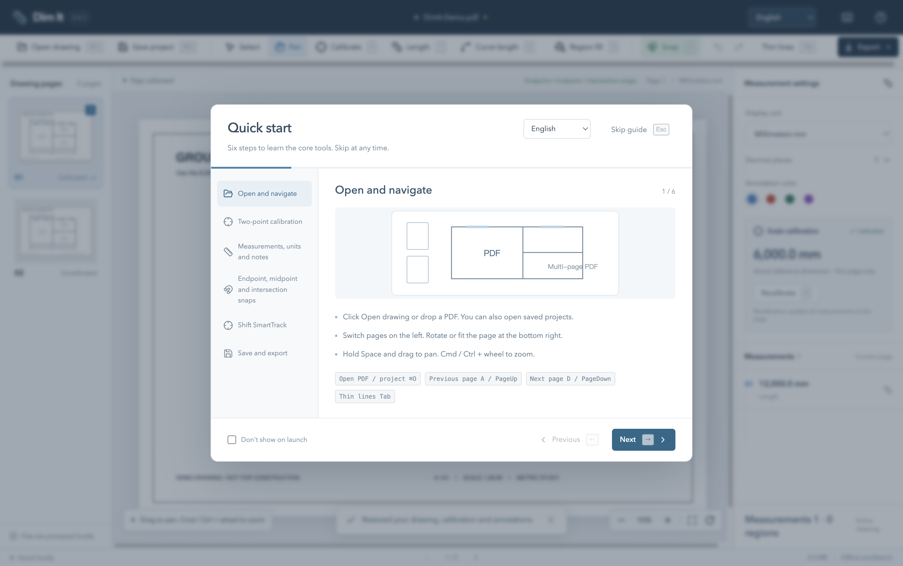
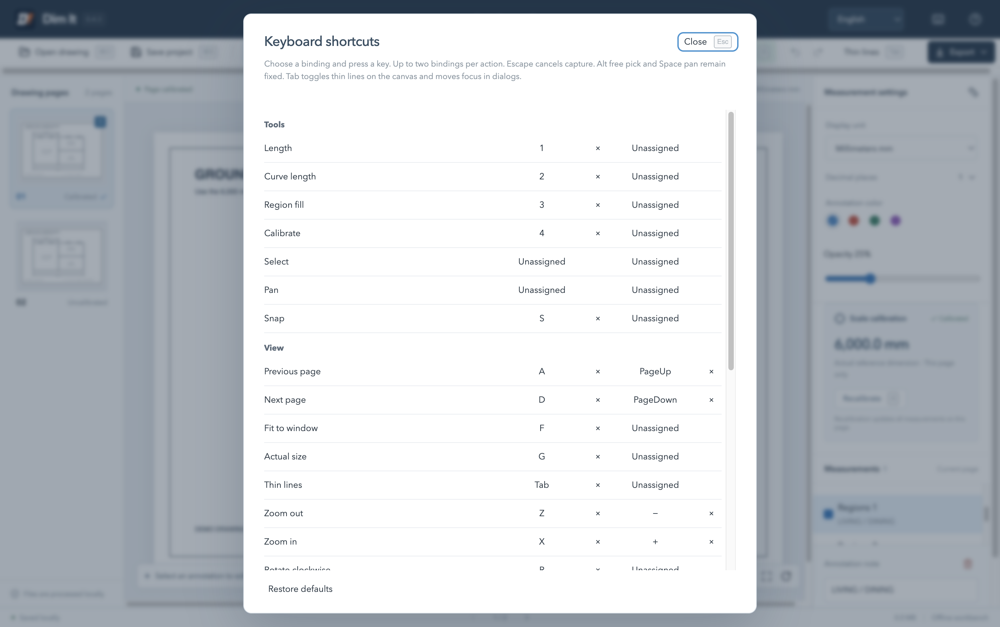

# Dim It - PDF Drawing Workbench


English · [简体中文](README.md) · [Download the latest release](https://github.com/bzbaizhen/dim-it/releases/latest)

An offline desktop tool for measuring PDF drawings. Calibrate the drawing with two points of a known dimension, then measure other distances. Built for everyday architectural, interior and engineering drawing checks on Windows and macOS.


## Download and install

Get the installer from [GitHub Releases](https://github.com/bzbaizhen/dim-it/releases).

| Platform            | Installation                                        |
| ------------------- | --------------------------------------------------- |
| Windows 10 / 11 x64 | Download the `.exe` and run the installation wizard |
| macOS Apple Silicon | Open the `.dmg` and drag Dim It into Applications   |

The current local development version is **0.4.3**. Published installers are listed in Releases. Installers are unsigned, so your operating system may show a publisher or security warning. Check the download source. macOS has been tested on actual hardware. Windows packages are cross-built and still require Windows hardware validation. The current macOS build is ARM64.

Choose **English** in the language selector at the top of the window or in the startup guide. The interface switches immediately and remembers your choice. Chinese is the default. Toolbars, measurement settings, calibration dialogs, snap and SmartTrack hints, the six-step guide and native application menus support both languages. Drawing content, filenames, user notes and measurement values are preserved.

## Core features

- **Open and navigate** local PDFs and `.planmeasure` projects. Drag and drop, page selection, pan, zoom and rotation. Files are processed locally.
- **Two-point calibration** from a known dimension and unit. Each page has its own scale. Recalibration updates measurements on that page.
- **Length measurements and annotations** with continuous two-point picking, notes, colors, deletion, undo and redo.
- **Arc and curve lengths** from existing vector paths. After calibration, click Curve length or press 2, hover to preview the full highlighted path, then click to record. Closed curves measure their full perimeter.
- **Region fills** with drag-to-draw rectangles and click-to-draw polygons, 25% default opacity, colors, notes, vertex editing and undo. Calibration is optional.
- **Thin lines** with Tab to show vector stroke centerlines at a uniform thin width.
- **Custom shortcuts** with grouped reference, primary and alternate bindings, conflict detection and local preferences.
- **Metric and imperial units** including mm, inches, feet and fractional feet/inches to the nearest 1/16 inch.
- **Object snapping** to vector line endpoints, midpoints and finite-segment intersections, with green markers and point-type labels.
- **Shift SmartTrack** for horizontal or vertical measurement alignment using nearby reference points and purple tracking guides.
- **Save and export** editable projects containing the original PDF, scales and annotations. Export annotated PDFs or CSV lists with dimensions, millimeter values and notes.
- **Skippable quick start** with six illustrated steps, a launch preference and a help entry for reopening the guide.

### Calibrate and measure

1. Open a PDF and zoom into a known dimension.
2. Click Calibrate, pick both ends, and enter a value such as `6000` mm, `3 1/2` inch or `8' 6"`.
3. Click Length and pick the endpoints of another distance. Measurements appear in the list automatically.
4. Use Save project to save editable work, or Export for PDF and CSV output.

The workspace screenshot above uses a generated demo with a 6,000 mm reference and a 12,000 mm measurement.

### Arc and curve length

Choose Curve length, hover over an existing vector arc or curve to preview its full path and length, then click to record it. Consecutive Bézier segments are measured together. Straight lines, disconnected subpaths and PDF drawing-object boundaries end the chain. Closed curves measure their full perimeter. Zoom and rotation preserve the measured dimension.

Lengths follow the actual PDF path using adaptive numerical subdivision. Scanned images and curves already converted into straight polylines cannot be detected automatically. Picking selects the whole curve chain.


Curve annotations support notes, colors, undo, recalibration and PDF / CSV export. Projects containing curves use v2 and require version 0.4.2 or later. Version 0.4.3 continues to read v1 and v2 projects.

### Highlighted snapping

Endpoints use a green square, midpoints a triangle and intersections a cross. Clicking uses the highlighted point's exact PDF coordinates. Press S to toggle snapping or hold Alt for temporary free picking.



### Shift SmartTrack

Pick a start point, hold Shift, then hover over a snap point for about 350 ms. Up to four recent reference points are retained. Purple dashed guides and a diamond indicate the orthogonal target. Click to confirm. Releasing Shift hides the guides temporarily, Esc cancels the current operation, and Alt permits free picking along the orthogonal direction.


### Quick start

The six-step illustrated guide appears on launch by default. Click Skip guide or press Esc to skip. Select Don't show on launch to remember your preference. Reopen it with Help in the top-right corner.



### Region fills and editing

Press **3** to fill a region. With an empty draft, hold the left mouse button and move more than 5 screen pixels to preview a rectangle, then release to finish. A click begins a polygon. Click more vertices, then close with Enter, a double-click, or a click on the first vertex after at least three valid vertices. Dragging within an active polygon adds a vertex. Backspace removes the last point. Escape cancels the draft, then returns to Select on the next press.


Use the palette and opacity control for new regions. Select a region to edit its color, opacity, note or vertices. Rectangle edits fix the opposite corner and retain right angles. Zero-area and self-intersecting edits restore the original shape. Clicking overlapping fills selects the topmost region. The list also selects underlying regions. Dimensions render above fills. Drawing, a vertex drag and an opacity adjustment each create one undo step.

Polygons support snapping, Shift orthogonal constraints and SmartTrack. Middle-mouse pan, Space-drag and zoom preserve drafts. Page changes and tool switches end unfinished drafts. Finish or cancel a draft before saving/exporting. PDF export includes Multiply-blended fills. CSV continues to list lengths. Projects containing regions use **v3 and require version 0.4.3 or later**.

### Tab thin-line display

Press **Tab** on the canvas or click Thin lines to toggle between original and uniform thin stroke widths, including while calibrating, measuring, selecting or drawing a region. Vector paths retain their original centerlines and snap coordinates through zoom and rotation. Raster images, filled shapes and ordinary filled text retain their appearance. Stroked or outlined text may also appear thinner. PDF exports retain original drawing widths. Tab within fields and dialogs moves focus.


## Shortcut reference and settings

`Mod` means Command on Mac and Ctrl on Windows. Use the keyboard icon or **Mod+, / F1** to open the same grouped settings panel.

| Action                              | Default                                     |
| ----------------------------------- | ------------------------------------------- |
| Line / Curve / Fill / Calibrate     | 1 / 2 / 3 / 4                               |
| Previous / Next page                | A / D, or PageUp / PageDown                 |
| Fit page / 100%                     | F / G                                       |
| Zoom out / In                       | Z / X, or − / +                             |
| Rotate clockwise / Counterclockwise | R / Shift+R                                 |
| Thin lines                          | Tab                                         |
| Snap / Edit note / Delete           | S / E / Delete                              |
| Undo / Redo                         | Mod+Z / Mod+Shift+Z, plus Ctrl+Y on Windows |
| Open / Save project                 | Mod+O / Mod+S                               |
| Export PDF / CSV                    | Mod+E / Mod+Shift+E                         |
| Shortcut settings                   | Mod+, / F1                                  |



Each action supports a primary and one alternate binding. Clear individual bindings or confirm a complete reset. Single keys and Mod/Shift combinations are supported. Conflicts identify the existing action. System/window and text-editing combinations are protected. Fields, selects and IME composition retain native editing. Only zoom, undo and redo repeat when held. Capture suspends workbench actions. Escape cancels capture. Closing settings resumes the current drawing. Preferences are stored locally, with a session-only warning if storage fails.

Select and Pan remain available through mouse controls. Middle-mouse or Space-drag pans temporarily. Shift enables orthogonal constraints and SmartTrack. Alt temporarily bypasses snapping. Pressing 1 or 2 on an uncalibrated page starts calibration and returns to the requested tool afterward. Text buttons show their current bindings and icon buttons show them on hover. Page navigation, view controls, export and settings entries update together. Native menus and the quick-start guide read the same configuration.

## Data and measurement limits

- One scale per page. Save separate projects for details with different scales on the same page. Scan distortion can affect measurements. Check against another known dimension.
- Automatic snapping uses vector straight lines and straight contour edges. Scanned images support manual calibration and picking.
- Local recovery retains the most recent work. Save a `.planmeasure` project before switching drawings.
- Exported PDF dimensions are drawn lines and text. Use the project file for continued editing. Notes are included in project and CSV files.
- Unlock encrypted PDFs in a reader before opening. Measurement tools support two-point lengths and whole vector-curve lengths.
- The repository and installers contain no customer drawings, customer projects, real drawing screenshots or local work data. Documentation images use generated geometry and the built-in demo.

## Development

Use Node.js 24+ and npm. Dependencies are pinned through `package-lock.json`.

```bash
npm ci
npm run desktop
```

Use `npm run dev` for browser development. Desktop mode provides native open and save dialogs.

```bash
npm run build
npm test
npm run test:e2e
npm run package:mac
npm run package:win
```

Test entry points generate synthetic geometric PDFs and a blank password test fixture. Generated fixtures are Git-ignored. UI tests use isolated temporary profiles and write to the ignored `test-results/` directory. Packages are written to `release/0.4.3/`. Building the macOS package requires macOS.

## Implementation and status

React / TypeScript, PDF.js, pdf-lib and Electron. Points use native PDF coordinates, calibration stores millimeters per PDF coordinate unit, and display/export convert units. Existing PlanMeasure `.planmeasure` projects and local recovery data remain compatible.

Version 0.4.3 is a local delivery validated on Apple Silicon Mac with a production build, 29 unit tests, nine Electron workflow suites and a smoke run of the final packaged Mac app. Coverage includes custom shortcuts, region fills, thin-line display, measurement, calibration, save/reopen, export, snapping, SmartTrack and bilingual onboarding. Both packages were checked for version, bundled resource consistency, customer drawing exclusion and SHA-256 integrity. The DMG structure was verified. Windows hardware validation remains open. The default source branch is `main`. Download binaries from the corresponding Release.
