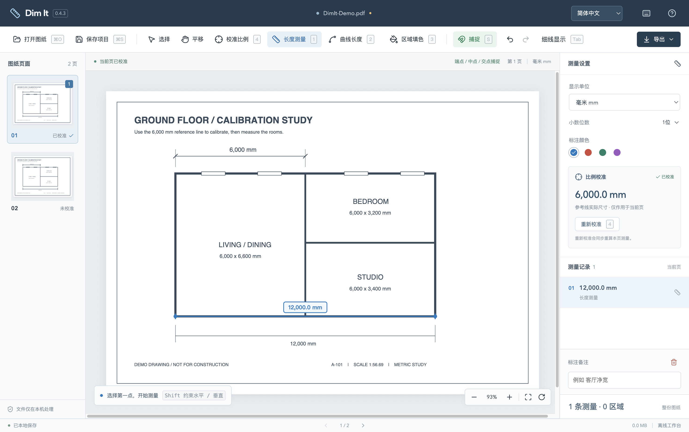
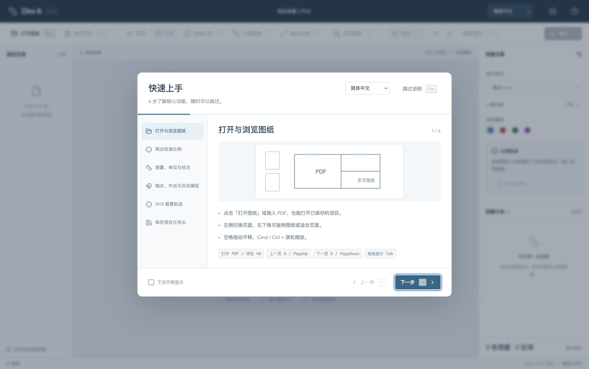

# Dim It - PDF 图纸工作台

[English](README.en.md) · 简体中文 · [下载最新版本](https://github.com/bzbaizhen/dim-it/releases/latest)

离线 PDF 图纸测量桌面工具。打开图纸，选取已知尺寸的两点校准比例，再快速测量其他距离。支持 Windows 与 macOS，适合建筑、室内与工程图纸的日常尺寸复核。



## 下载与安装

在 [GitHub Releases](https://github.com/bzbaizhen/dim-it/releases) 下载对应系统的安装包。

| 系统                | 安装方式                                       |
| ------------------- | ---------------------------------------------- |
| Windows 10 / 11 x64 | 下载 `.exe`，运行安装向导，可选择安装位置      |
| macOS Apple Silicon | 下载 `.dmg`，打开后将 Dim It 拖入 Applications |

当前本地开发版本为 **0.4.2**，已发布安装包以 Releases 为准。安装包尚未签名，系统可能显示未知发布者或安全提示。请核对下载来源。macOS 已实际运行验证，Windows 已交叉构建，实机验收待完成。当前 macOS 包为 ARM64。

## 界面语言

在窗口顶部或启动说明右上角选择 **简体中文 / English**，界面立即切换，并记住下次启动的偏好。默认使用中文。语言切换覆盖工具栏、测量设置、校准弹窗、捕捉与智慧轨迹提示、六步说明和原生应用菜单。图纸内容、文件名、用户备注与测量数值保留原值。

## 核心功能

- **打开与浏览**。本地 PDF 与 `.planmeasure` 项目，支持拖入文件、多页切换、平移、缩放和旋转。文件处理在本机进行。
- **两点校准**。在已知尺寸上选两点，输入真实长度与单位。每页独立保存比例，重新校准会重算该页测量。
- **长度测量与标注**。连续选择起点、终点，自动生成尺寸记录。支持备注、颜色、删除、撤销和重做。
- **弧线与曲线长度**。校准后点击「曲线长度」或按 L，靠近已有矢量曲线时高亮整段，点击记录沿线长度。支持闭合曲线完整周长。
- **公英制单位**。mm、inch、feet、英尺英寸自由切换，英尺英寸支持分数显示到最近 1/16 inch。
- **对象捕捉**。自动捕捉矢量直线端点、中点、有限线段交点，绿色形状与文字高亮当前捕捉点。
- **Shift 智慧轨迹**。强制水平或垂直时，可悬停获取附近捕捉点，利用紫色追踪线对齐正交落点。
- **保存与导出**。项目包含原 PDF、逐页比例与可编辑标注。可导出带尺寸 PDF 或尺寸、毫米原值与备注的 CSV 清单。
- **启动使用说明**。6 步图文快速上手，支持随时跳过、下次不再显示及从帮助入口重看。

### 两点校准与连续测量

1. 打开 PDF，放大图上已有明确尺寸的位置。
2. 点击「校准比例」，依次选取该尺寸两端，输入例如 `6000` mm、`3 1/2` inch 或 `8' 6"`。
3. 点击「长度测量」，依次选取其他距离的两点。右侧列表自动记录测量结果。
4. 使用「保存项目」保留可编辑工作，使用「导出」输出 PDF 或 CSV。

上方工作区截图使用程序生成的示意图，展示 6,000 mm 校准与 12,000 mm 测量结果。

### 弧线与曲线长度

选中「曲线长度」后，靠近图纸已有的矢量弧线或曲线，预览整段高亮及长度，再点击记录。连续 Bézier 曲线段一起测量，遇到直线、断开的子路径或 PDF 绘制对象边界时结束。闭合曲线测量完整周长，缩放与旋转不影响记录的实际尺寸。

长度采用自适应数值细分，依据 PDF 中的实际曲线路径计算。扫描图像或已离散成直线的折线无法自动识别为曲线。此功能选取整段路径。


曲线支持备注、颜色、撤销、重算和 PDF / CSV 导出。含曲线的项目保存为 v2，需使用 0.4.2 及以上版本打开。0.4.2 继续支持旧版 v1 项目。

### 捕捉点高亮

靠近可捕捉点时出现绿色标记。端点为方框，中点为三角，交点为叉号。点击采用高亮点的精确 PDF 坐标。S 切换捕捉，Alt 临时自由选点。


### Shift 智慧轨迹

先选起点，再按住 Shift，悬停端点、中点或交点约 350 ms。最多保留最近 4 个参考点，紫色虚线与菱形指示正交落点。点击确认，松开 Shift 暂时隐藏追踪，Esc 取消当前操作。Alt 可沿正交方向自由选点。


### 可跳过的快速上手

默认启动时显示 6 步说明，每步配示意图与快捷键。点击「跳过说明」或按 Esc 可直接使用，勾选「下次不再显示」保存偏好。右上角「使用帮助」可随时重看。



## 常用快捷键

| 操作                    | 快捷键                      |
| ----------------------- | --------------------------- |
| 打开 / 保存项目         | Cmd / Ctrl + O / S          |
| 校准 / 长度测量         | C / M                       |
| 曲线长度                | L                           |
| 选择 / 平移             | V / H                       |
| 临时平移                | 空格 + 拖动，或鼠标中键     |
| 缩放                    | Cmd / Ctrl + 滚轮，或 + / - |
| 正交与智慧轨迹          | 选起点后按住 Shift          |
| 捕捉开关 / 临时自由选点 | S / Alt                     |
| 撤销 / 重做             | Cmd / Ctrl + Z / Shift + Z  |
| 取消 / 删除             | Esc / Delete 或 Backspace   |

Windows 也支持 Ctrl + Y 重做。

## 数据与测量边界

- 每页一个比例。同页存在不同比例详图时需分别保存项目处理。扫描拉伸或透视失真会影响结果，建议使用另一个已知尺寸复核。
- 自动捕捉针对 PDF 矢量直线与轮廓直边。扫描图片可手动校准与选点。
- 自动恢复保留本机最近一份工作。打开另一份图纸前请保存 `.planmeasure` 项目。
- 导出 PDF 中的尺寸为绘入页面的线条与文本。继续编辑请打开项目文件。备注保存在项目和 CSV 中。
- 加密 PDF 需要先在阅读器解锁。支持两点长度和整段矢量曲线长度测量。
- 仓库与安装包不包含客户图纸、客户项目、真实图纸截图或本地工作数据。文档截图来自合成几何与内置演示。

## 本地开发

使用 Node.js 24+ 与 npm，依赖由 `package-lock.json` 锁定。

```bash
npm ci
npm run desktop
```

浏览器调试执行 `npm run dev`。桌面模式提供原生文件打开与保存对话框。

```bash
npm run build
npm test
npm run test:e2e
npm run package:mac
npm run package:win
```

测试入口自动生成纯几何 PDF 与空白加密校验样本，生成文件被 Git 忽略。UI 测试使用隔离临时用户数据目录，输出位于被忽略的 `test-results/`。打包输出在 `release/0.4.2/`。打包 macOS 需要 Mac 环境。

## 实现与当前状态

React / TypeScript、PDF.js、pdf-lib 与 Electron。选点保存为 PDF 原生坐标，比例以 mm / PDF 坐标单位表示，显示与导出时换算单位。兼容早期 PlanMeasure 的 `.planmeasure` 项目与本机自动恢复数据。

0.4.2 已在 Apple Silicon Mac 上通过生产构建、14 项核心测试及 Electron 工作流验证，覆盖曲线长度、校准、单位、保存重开、导出、捕捉、智慧轨迹、启动引导与异常恢复。Windows 实机验收是当前开放项。源码默认分支为 `main`，发布制品以对应 Release 为准。
