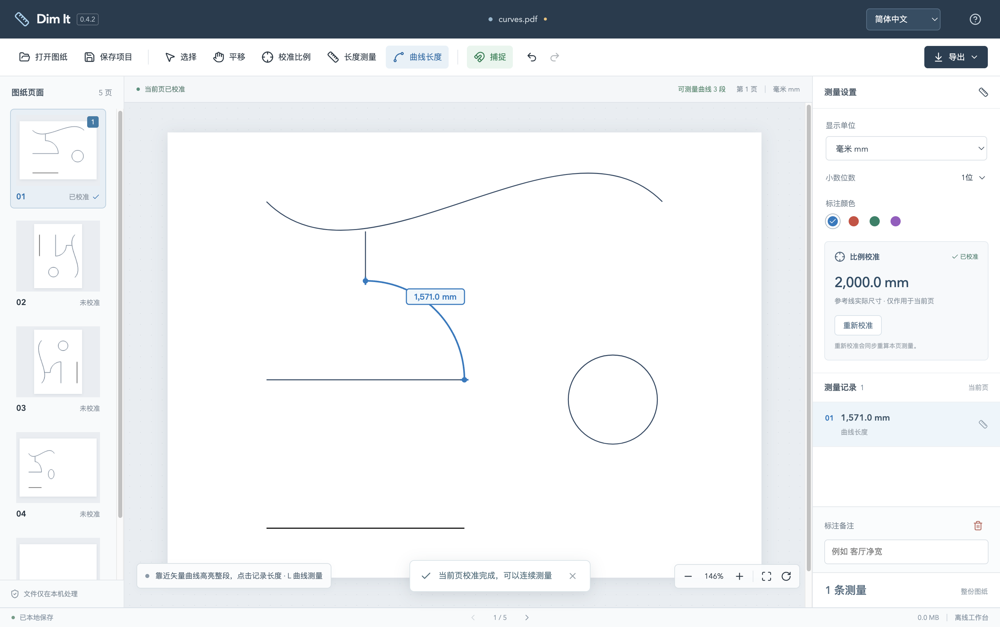
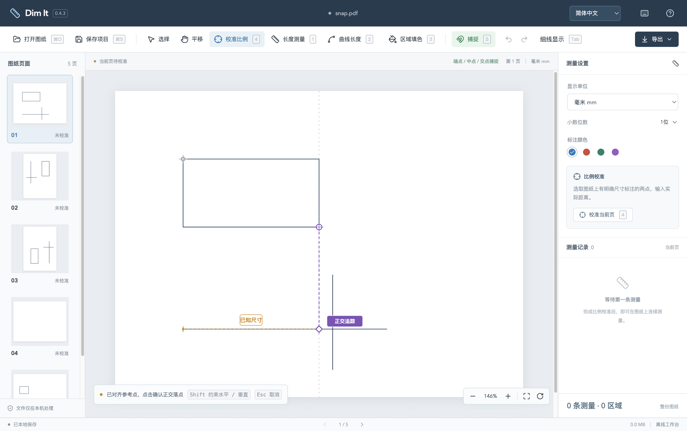
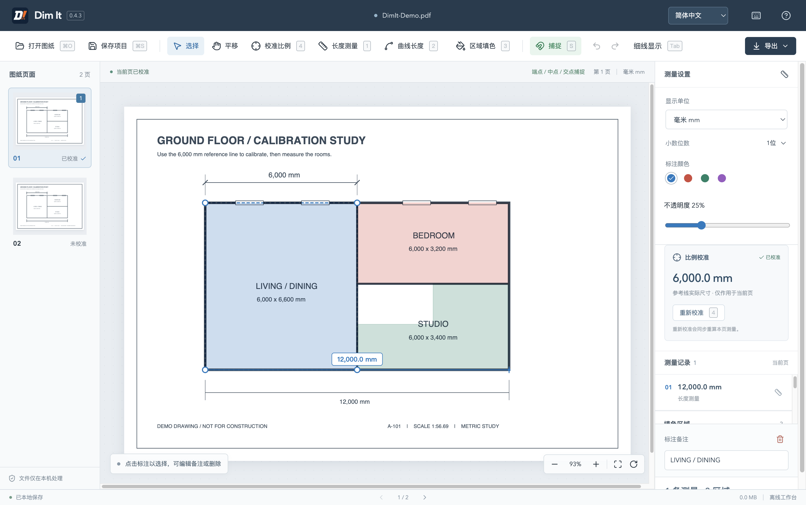
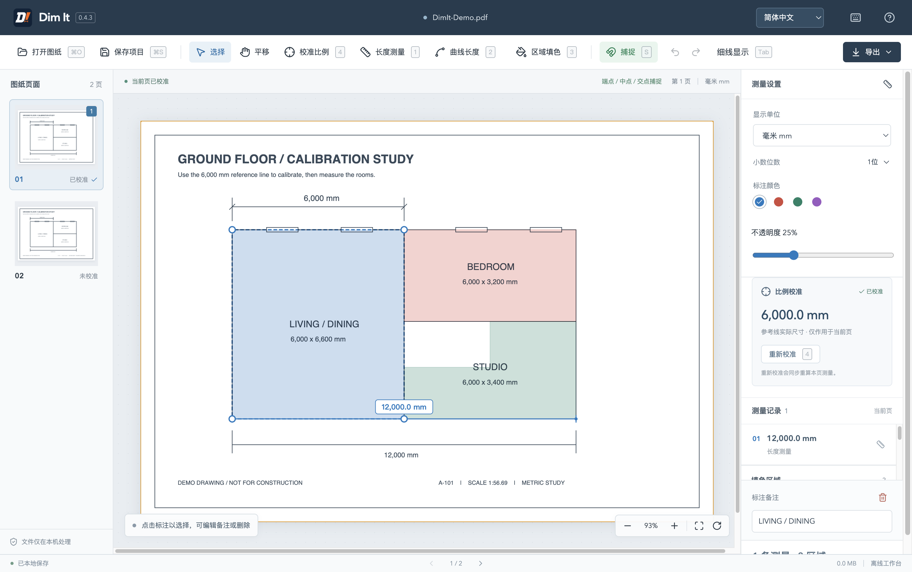

# Dim It - PDF 图纸工作台

**离线 PDF 图纸测量与标注工具。** 打开图纸，用已知尺寸校准比例，再测量直线、曲线并标记区域。适合建筑、室内与工程图纸的日常尺寸复核。

*Damn it. Dim it.*

[English](README.en.md) · 简体中文 · [下载最新版本](https://github.com/bzbaizhen/dim-it/releases/latest) · [详细使用说明](docs/usage.md)

## 下载与安装

在 Releases 下载对应系统的安装包。当前版本为 **0.4.3**。[下载最新版本](https://github.com/bzbaizhen/dim-it/releases/latest)

| 系统 | 安装方式 | 签名状态 |
| --- | --- | --- |
| macOS Apple Silicon（ARM64） | 打开 `.dmg`，将 Dim It 拖入 Applications | Developer ID 签名，已通过 Apple 公证 |
| Windows 10 / 11 x64 | 运行 `.exe` 安装向导，可选择安装位置 | 尚未签名，系统可能显示安全提示 |

Mac 版本已在 Apple Silicon 上实际运行验证。Windows 安装包已交叉构建，Windows 实机验收待完成。每个 Release 附有 `SHA256SUMS.txt`，可用于核对下载文件。

## 一分钟上手

1. **打开图纸**。点击打开，或将 PDF 拖入窗口。也可先打开内置演示图。
2. **校准比例**。按 **4**，选取已知尺寸的两个端点，输入实际长度与单位，例如 `6000` mm。
3. **开始测量**。按 **1** 测量直线，或按 **2** 点击已有矢量曲线测量整段长度。结果自动加入右侧列表。
4. **保存与分享**。保存 `.planmeasure` 项目以便继续编辑，或导出带标注 PDF、尺寸 CSV 清单。

区域填色可直接按 **3** 开始。窗口顶部可切换 **简体中文 / English**，语言偏好会自动保存。首次启动的图文说明支持跳过，可通过右上角「使用帮助」重看。

## 核心功能

| 功能 | 可以完成的操作 |
| --- | --- |
| 长度测量 | 两点测量直线，点击矢量弧线或曲线测量整段，支持闭合曲线周长 |
| 比例与单位 | 每页独立校准，支持 mm、inch、feet 和分数英尺英寸 |
| 捕捉与对齐 | 高亮端点、中点和交点，Shift 正交与 SmartTrack 辅助对齐 |
| 区域填色 | 拖出矩形或逐点绘制多边形，调整颜色、透明度、备注和顶点 |
| 图纸浏览 | 多页切换、平移、缩放、旋转，Tab 切换统一细线显示 |
| 标注编辑 | 备注、颜色、选择、删除、撤销和重做 |
| 操作效率 | 可自定义快捷键，按钮提示与原生菜单同步显示当前键位 |

### 测量矢量曲线

校准后按 **2**，靠近曲线预览整段高亮，再点击记录长度。

### 捕捉与智慧轨迹

捕捉点以绿色标记高亮。按住 **Shift** 约束水平或垂直方向，悬停附近捕捉点可获取 SmartTrack 参考，沿紫色引导线对齐落点。

### 矩形与多边形填色

按 **3**，拖动绘制矩形，或逐点单击绘制多边形。默认不透明度为 25%，完成后可选中区域编辑样式、备注与顶点。

### Tab 细线显示

画布按 **Tab** 显示矢量线的中心路径，便于辨认交点。校准、测量和绘制过程中均可切换。

详细选点、闭合、顶点编辑和快捷键设置操作见使用说明。[详细使用说明](docs/usage.md)

## 快捷键

`Mod` 在 Mac 上代表 Command，在 Windows 上代表 Ctrl。按 **Mod+, / F1** 或点击键盘图标查看并自定义绑定。

| 操作 | 默认键位 |
| --- | --- |
| 直线 / 曲线 / 填色 / 校准 | 1 / 2 / 3 / 4 |
| 上一页 / 下一页 | A / D，或 PageUp / PageDown |
| 适合页面 / 100% | F / G |
| 缩小 / 放大 | Z / X，或 − / + |
| 顺时针 / 逆时针旋转 | R / Shift+R |
| 细线显示 | Tab |
| 捕捉开关 / 编辑备注 / 删除 | S / E / Delete |
| 撤销 / 重做 | Mod+Z / Mod+Shift+Z，Windows 兼容 Ctrl+Y |
| 打开 / 保存项目 | Mod+O / Mod+S |
| 导出 PDF / CSV | Mod+E / Mod+Shift+E |
| 快捷键设置 | Mod+, / F1 |

中键或 **空格 + 拖动**临时平移，**Shift** 正交与 SmartTrack，**Alt** 临时自由选点。输入框和弹窗中的 Tab 用于焦点导航。

## 保存与隐私

图纸处理与项目恢复在本机进行，测量和标注可离线使用。

| 格式 | 用途 | 包含内容 |
| --- | --- | --- |
| `.planmeasure` | 保存工作，稍后继续编辑 | 原 PDF、逐页比例、测量、填色与备注 |
| PDF | 分享或打印标注结果 | 原图纸与绘入页面的尺寸、填色 |
| CSV | 整理尺寸清单 | 长度、毫米原值与备注 |

自动恢复保留本机最近一份工作。切换图纸前请保存项目文件。文档截图使用合成几何与内置演示。

## 使用限制与常见问题

- **扫描图可以测量吗？** 可以手动校准与选点。自动捕捉和整段曲线识别依赖 PDF 中的矢量路径。
- **同页有多个比例怎么办？** 每页保存一个比例，不同比例详图可分别保存项目处理。扫描拉伸或透视失真会影响结果，可用另一个已知尺寸复核。
- **导出的 PDF 如何继续编辑？** 在 Dim It 中打开保存的 `.planmeasure` 项目，继续调整测量与区域。
- **为何曲线无法选中？** 曲线可能已转为图片或直线折线。连续矢量曲线的选取范围以 PDF 路径边界为准。
- **为何保存时提示有草稿？** 完成区域闭合，或按 Esc 取消当前草稿后保存。
- **加密 PDF 如何打开？** 先在阅读器中解锁并保存，再导入 Dim It。

## 反馈与开发

提交问题时请附系统、软件版本、复现步骤及脱敏示例。[反馈问题](https://github.com/bzbaizhen/dim-it/issues)

- [版本与更新记录](https://github.com/bzbaizhen/dim-it/releases)
- [详细使用说明](docs/usage.md)
- [本地开发、构建与签名发布](docs/development.md)

项目当前授权标记为 `UNLICENSED`，记录于项目配置。授权事宜可通过 Issues 联系。[项目配置](package.json)
