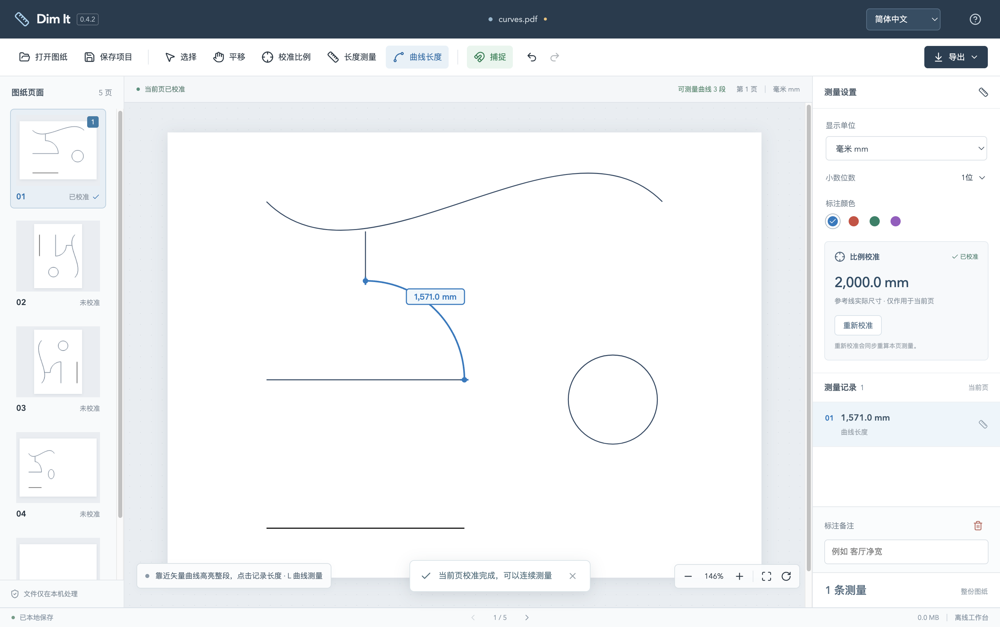
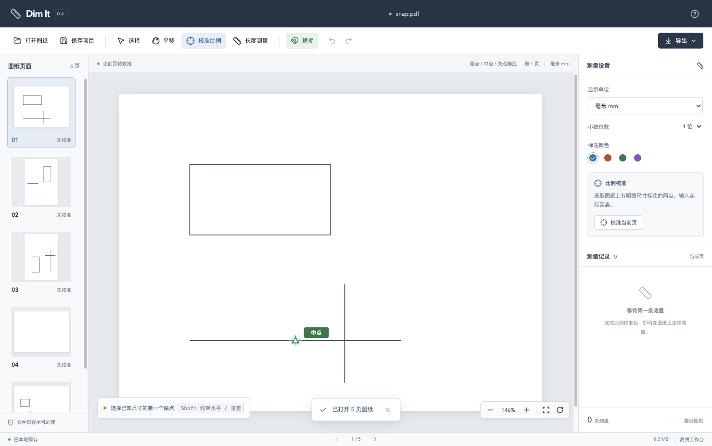
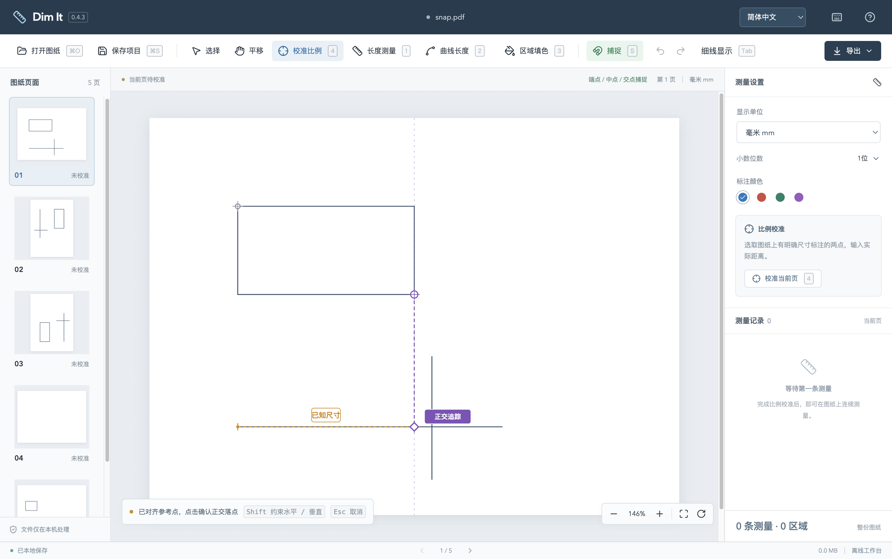
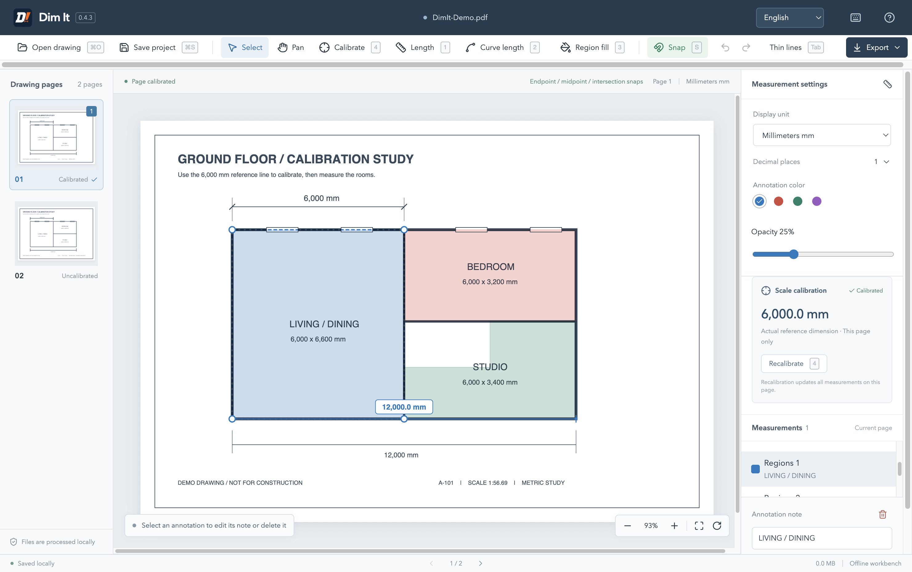
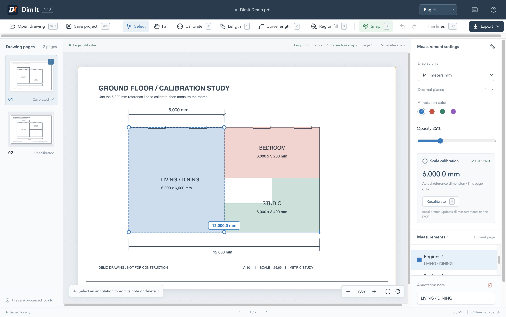
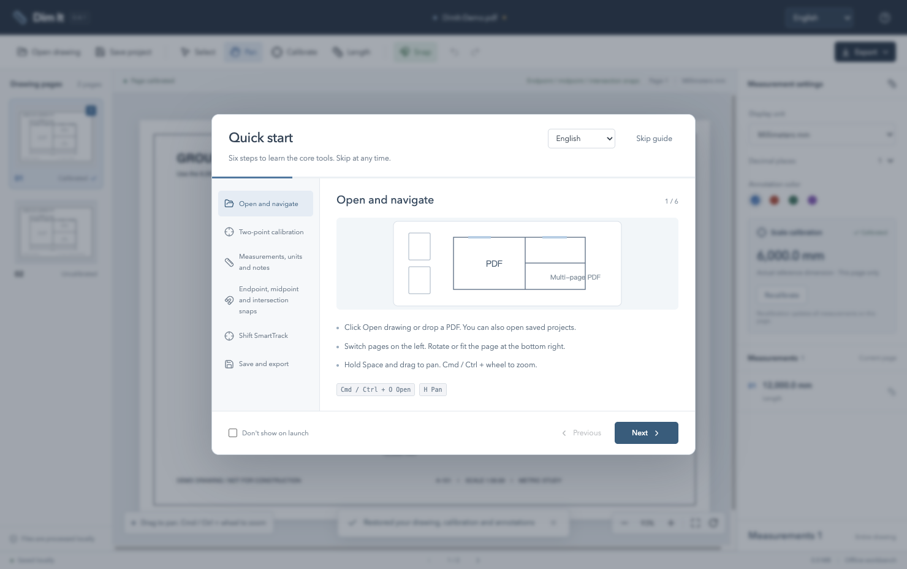
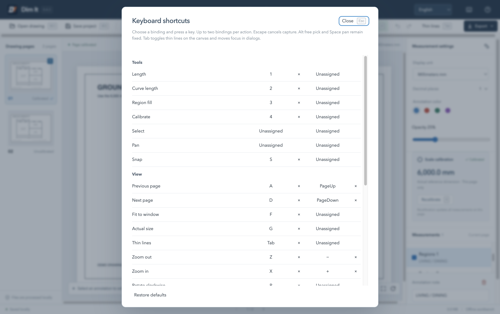

# Detailed usage

[简体中文](usage.md) · [Back to README](../README.en.md)

## Calibrate and measure

1. Open a PDF and zoom into a known dimension.
2. Click Calibrate, pick both ends, and enter a value such as `6000` mm, `3 1/2` inch or `8' 6"`.
3. Click Length and pick the endpoints of another distance. Measurements appear in the list automatically.
4. Use Save project to save editable work, or Export for PDF and CSV output.

The README workspace screenshot uses a generated demo with a 6,000 mm reference and a 12,000 mm measurement.

## Arc and curve length

Choose Curve length, hover over an existing vector arc or curve to preview its full path and length, then click to record it. Consecutive Bézier segments are measured together. Straight lines, disconnected subpaths and PDF drawing-object boundaries end the chain. Closed curves measure their full perimeter. Zoom and rotation preserve the measured dimension.

Lengths follow the actual PDF path using adaptive numerical subdivision. Scanned images and curves already converted into straight polylines cannot be detected automatically. Picking selects the whole curve chain.

Curve annotations support notes, colors, undo, recalibration and PDF / CSV export. Projects containing curves use v2 and require version 0.4.2 or later. Version 0.4.3 continues to read v1 and v2 projects.

## Highlighted snapping

Endpoints use a green square, midpoints a triangle and intersections a cross. Clicking uses the highlighted point's exact PDF coordinates. Press S to toggle snapping or hold Alt for temporary free picking.

## Shift SmartTrack

Pick a start point, hold Shift, then hover over a snap point for about 350 ms. Up to four recent reference points are retained. Purple dashed guides and a diamond indicate the orthogonal target. Click to confirm. Releasing Shift hides the guides temporarily, Esc cancels the current operation, and Alt permits free picking along the orthogonal direction.

## Region fills and editing

Press **3** to fill a region. With an empty draft, hold the left mouse button and move more than 5 screen pixels to preview a rectangle, then release to finish. A click begins a polygon. Click more vertices, then close with Enter, a double-click, or a click on the first vertex after at least three valid vertices. Dragging within an active polygon adds a vertex. Backspace removes the last point. Escape cancels the draft, then returns to Select on the next press.

Use the palette and opacity control for new regions. Select a region to edit its color, opacity, note or vertices. Rectangle edits fix the opposite corner and retain right angles. Zero-area and self-intersecting edits restore the original shape. Clicking overlapping fills selects the topmost region. The list also selects underlying regions. Dimensions render above fills. Drawing, a vertex drag and an opacity adjustment each create one undo step.

Polygons support snapping, Shift orthogonal constraints and SmartTrack. Middle-mouse pan, Space-drag and zoom preserve drafts. Page changes and tool switches end unfinished drafts. Finish or cancel a draft before saving/exporting. PDF export includes Multiply-blended fills. CSV continues to list lengths. Projects containing regions use **v3 and require version 0.4.3 or later**.

## Tab thin-line display

Press **Tab** on the canvas or click Thin lines to toggle between original and uniform thin stroke widths, including while calibrating, measuring, selecting or drawing a region. Vector paths retain their original centerlines and snap coordinates through zoom and rotation. Raster images, filled shapes and ordinary filled text retain their appearance. Stroked or outlined text may also appear thinner. PDF exports retain original drawing widths. Tab within fields and dialogs moves focus.

## Quick start

The six-step illustrated guide appears on launch by default. Click Skip guide or press Esc to skip. Select Don't show on launch to remember your preference. Reopen it with Help in the top-right corner.

## Shortcut settings

Default bindings are listed in the README. [Shortcut reference](../README.en.md#shortcuts)

Each action supports a primary and one alternate binding. Clear individual bindings or confirm a complete reset. Single keys and Mod/Shift combinations are supported. Conflicts identify the existing action. System/window and text-editing combinations are protected. Fields, selects and IME composition retain native editing. Only zoom, undo and redo repeat when held. Capture suspends workbench actions. Escape cancels capture. Closing settings resumes the current drawing. Preferences are stored locally, with a session-only warning if storage fails.

Select and Pan remain available through mouse controls. Middle-mouse or Space-drag pans temporarily. Shift enables orthogonal constraints and SmartTrack. Alt temporarily bypasses snapping. Pressing 1 or 2 on an uncalibrated page starts calibration and returns to the requested tool afterward. Text buttons show their current bindings and icon buttons show them on hover. Page navigation, view controls, export and settings entries update together. Native menus and the quick-start guide read the same configuration.
