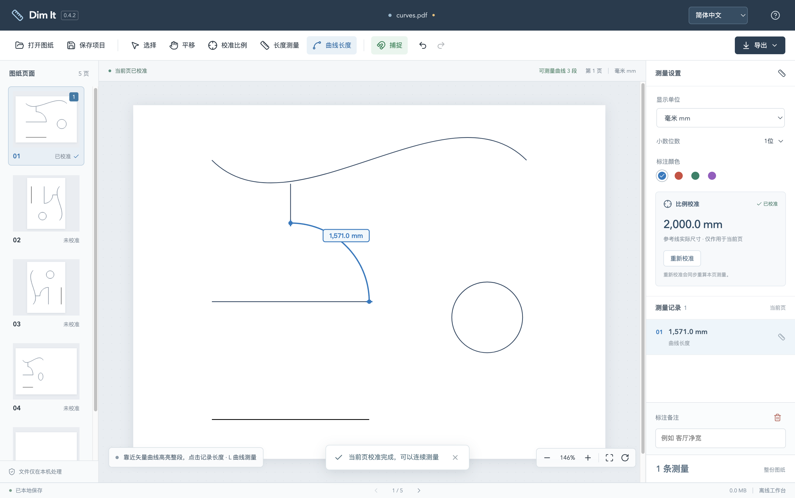
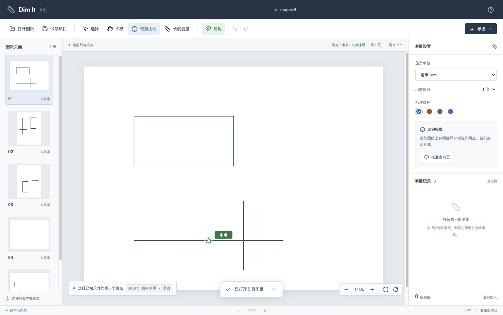
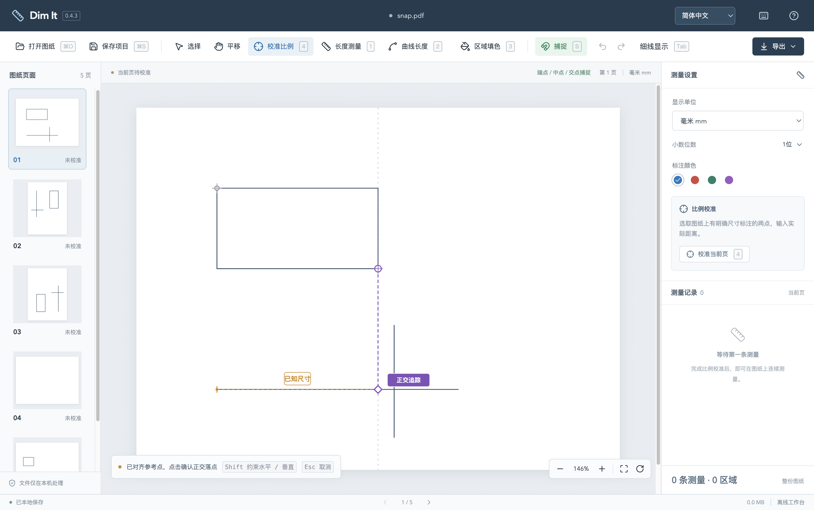
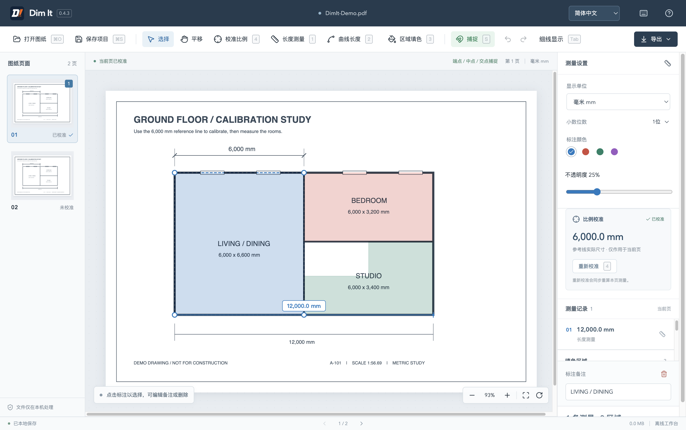
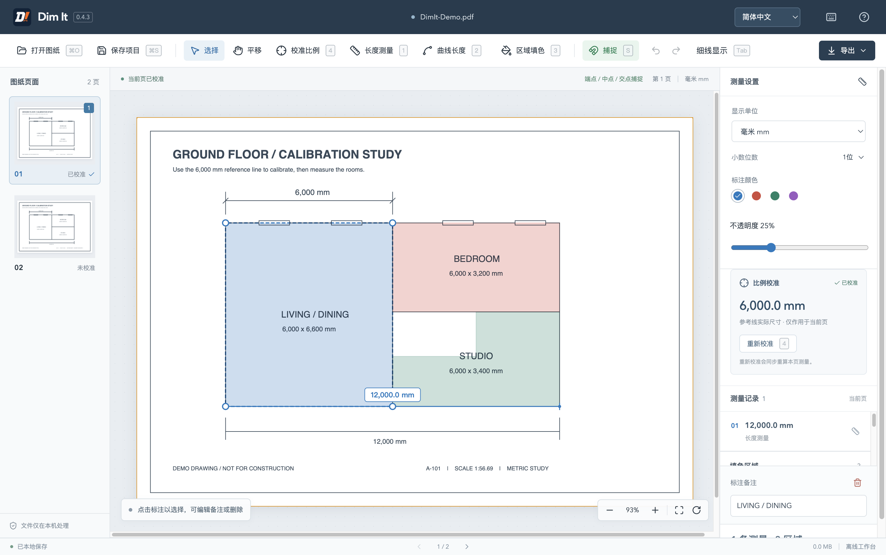
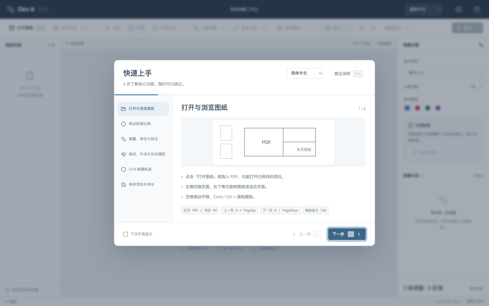
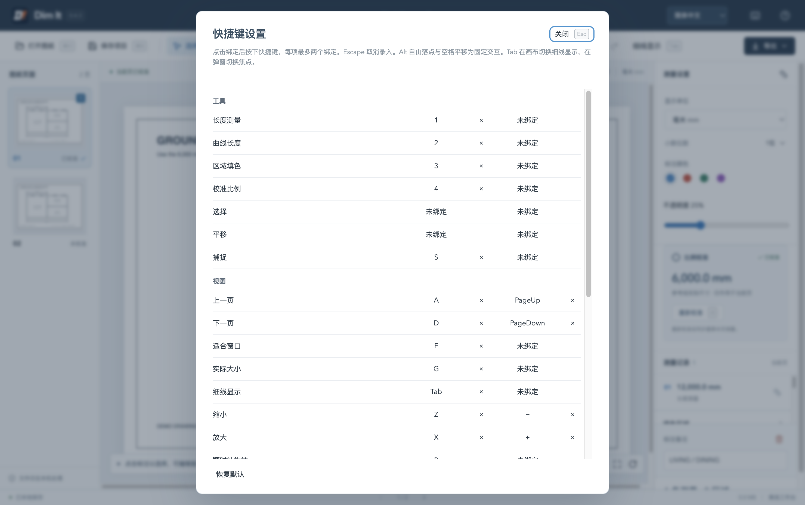

# 详细使用说明

[English](usage.en.md) · [返回 README](../README.md)

## 两点校准与连续测量

1. 打开 PDF，放大图上已有明确尺寸的位置。
2. 点击「校准比例」，依次选取该尺寸两端，输入例如 `6000` mm、`3 1/2` inch 或 `8' 6"`。
3. 点击「长度测量」，依次选取其他距离的两点。右侧列表自动记录测量结果。
4. 使用「保存项目」保留可编辑工作，使用「导出」输出 PDF 或 CSV。

README 工作区截图使用程序生成的示意图，展示 6,000 mm 校准与 12,000 mm 测量结果。

## 弧线与曲线长度

选中「曲线长度」后，靠近图纸已有的矢量弧线或曲线，预览整段高亮及长度，再点击记录。连续 Bézier 曲线段一起测量，遇到直线、断开的子路径或 PDF 绘制对象边界时结束。闭合曲线测量完整周长，缩放与旋转不影响记录的实际尺寸。

长度采用自适应数值细分，依据 PDF 中的实际曲线路径计算。扫描图像或已离散成直线的折线无法自动识别为曲线。此功能选取整段路径。

曲线支持备注、颜色、撤销、重算和 PDF / CSV 导出。含曲线的项目保存为 v2，需使用 0.4.2 及以上版本打开。0.4.3 继续支持 v1、v2 项目。

## 捕捉点高亮

靠近可捕捉点时出现绿色标记。端点为方框，中点为三角，交点为叉号。点击采用高亮点的精确 PDF 坐标。S 切换捕捉，Alt 临时自由选点。

## Shift 智慧轨迹

先选起点，再按住 Shift，悬停端点、中点或交点约 350 ms。最多保留最近 4 个参考点，紫色虚线与菱形指示正交落点。点击确认，松开 Shift 暂时隐藏追踪，Esc 取消当前操作。Alt 可沿正交方向自由选点。

## 区域填色与编辑

按 **3** 进入填色。在空白草稿中按住左键，移动超过 5 个屏幕像素后拖出矩形，松开完成。单击开始多边形，继续单击添加顶点，至少三个有效顶点后，按 Enter、双击或点击起点闭合。已开始的多边形中拖动也只追加一个顶点。Backspace 撤回最后一点，Esc 取消草稿，再按 Esc 返回选择状态。

绘制前通过右侧调色板与不透明度设置新区域样式。选中区域后调整其样式或备注，拖动顶点修改轮廓。矩形拖角固定对角并保持直角，无效的零面积或自交边界会恢复原形状。区域按绘制顺序叠加，点击选取最上层，右侧列表可选取下层。尺寸标注显示在填色上方。每次绘制、顶点拖动、一次不透明度调整分别支持撤销。

多边形支持捕捉、Shift 正交与 SmartTrack。中键、空格拖动和缩放保留草稿，翻页或切换工具会结束未完成草稿。保存或导出前需要完成或取消草稿。区域以 Multiply 混合写入 PDF，CSV 保留长度清单。含区域项目保存为 **v3，需要 0.4.3 及以上版本**。

## Tab 细线显示

画布按 **Tab**，或点击工具栏「细线显示」，在原始线宽与统一细线宽之间切换。校准、测量、填色草稿和选择状态均可切换。矢量线保留原始中心路径与捕捉坐标，缩放和旋转后仍显示为细线。扫描图片、填充图形和普通填充文字保留原显示，描边或轮廓化文字也可能变细，导出 PDF 使用原图线宽。输入框和弹窗里的 Tab 用于焦点切换。

## 可跳过的快速上手

默认启动时显示 6 步说明，每步配示意图与快捷键。点击「跳过说明」或按 Esc 可直接使用，勾选「下次不再显示」保存偏好。右上角「使用帮助」可随时重看。

## 快捷键设置

默认键位见 README 中的速查表。[快捷键速查](../README.md#快捷键)

每项支持主键和一个备选键，可清除绑定，恢复全部默认需要确认。允许单键、Mod、Shift 组合，冲突时提示占用功能。系统窗口与文本编辑组合受到保护，输入框、下拉框与输入法组合输入保留编辑行为。长按仅缩放、撤销、重做连续生效。快捷键录入时暂停工作台操作，Esc 取消录入，关闭面板后继续原来的绘制。配置独立保存在本机，存储失败时提示仅在当前会话生效。

选择和平移保留鼠标入口。中键或空格拖动临时平移，Shift 正交与 SmartTrack，Alt 临时自由选点。未校准时按 1 或 2 会引导校准，完成后进入原先请求的工具。有绑定的文字按钮直接显示当前键位，图标按钮悬停显示提示，翻页、视图控制、导出和设置入口也同步更新。原生菜单和启动说明读取同一配置。
